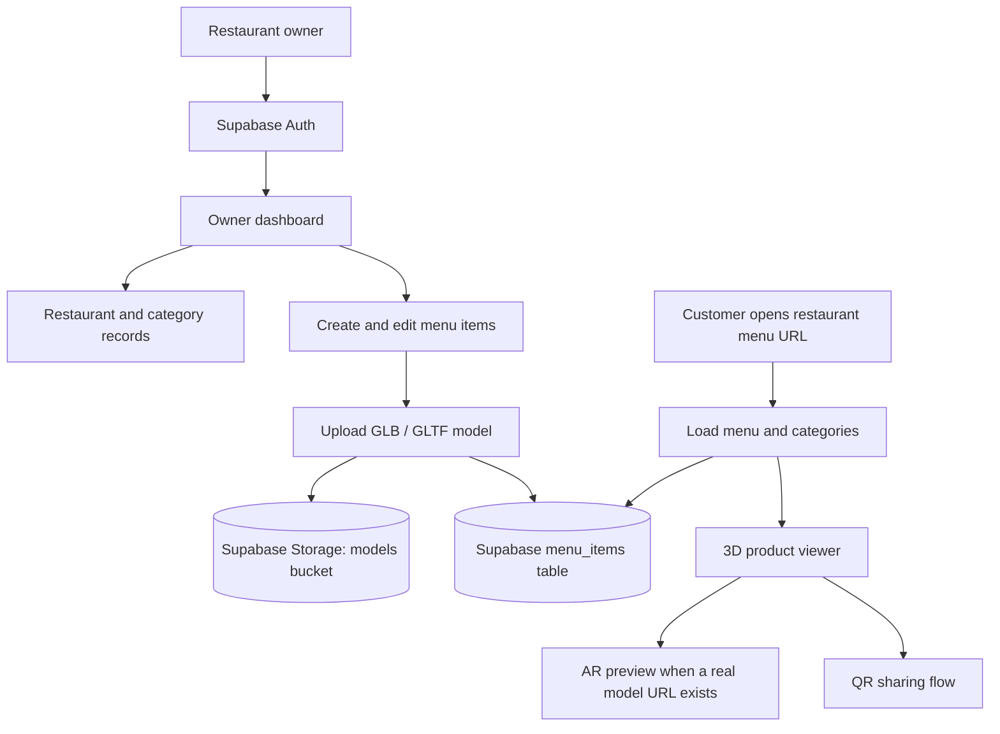

# Tasty Realities — MenuAR 3D and AR Restaurant Menu

Tasty Realities is a restaurant-menu experience concept that combines a public digital menu with interactive 3D food models and an augmented-reality viewing flow. Restaurant owners can manage menu content and upload GLB/GLTF assets through a dashboard backed by Supabase.


## Why it matters

A menu description does not always communicate portion, presentation, or plating. MenuAR explores how a customer could inspect a dish as a 3D object and, where a real model is available, preview it in an AR-capable browser or device.

## Product flow



## What is implemented

- Landing page with product overview, feature sections, and pricing presentation.
- Supabase email/password sign-up and sign-in flow.
- Restaurant dashboard that loads the owner's restaurant, categories, and menu items from Supabase.
- Restaurant creation and menu-item management flows.
- GLB/GLTF upload to a Supabase Storage bucket named `models`.
- Menu model URLs saved back to the `menu_items` table.
- Public menu route with category filtering and a sample-menu fallback.
- 3D model viewing and AR entry using Google's `model-viewer`.
- QR-code generation and sharing components.
- Dedicated viewer route with sample dishes for demonstrating the 3D/AR interface.

## Demo and integration boundaries

- The public menu can fall back to local demo menu items when no restaurant data is returned.
- The dedicated `/viewer` route uses hard-coded example dishes; it is a presentation route, not a live restaurant-specific product feed.
- Demo menu items use a `demo` model marker and show a placeholder instead of launching a real AR asset.
- AR placement requires an uploaded and accessible GLB/GLTF model and a compatible browser/device.
- Supabase features require a correctly configured project, database schema, storage bucket, and access policies. This README does not claim that a production Supabase project is provisioned.

## Technology

React 18 · TypeScript · Vite · Supabase Auth/Database/Storage · React Router · TanStack Query · Three.js · React Three Fiber · Google Model Viewer · QRCode · Framer Motion · Tailwind CSS

## Configuration

The Supabase client reads these Vite variables:

```env
VITE_SUPABASE_URL=your_supabase_project_url
VITE_SUPABASE_PUBLISHABLE_KEY=your_supabase_publishable_key
```

Configure the `restaurants`, `categories`, and `menu_items` tables plus the `models` storage bucket and policies in your Supabase project. Use only a publishable client key in browser code.

## Run locally

```bash
npm install
npm run dev
```

Build and test commands:

```bash
npm run build
npm run lint
npm test
```

Playwright is also included in the development dependencies for browser-level testing.

## Main routes

| Route | Purpose |
| --- | --- |
| `/` | Product landing page |
| `/auth` | Sign up and sign in |
| `/dashboard` | Restaurant setup and menu management |
| `/menu/:slug` | Public restaurant menu |
| `/viewer` | Demo 3D/AR product viewer |

## Evidence status

No public model-viewing performance, conversion-rate, device-compatibility, or restaurant-adoption benchmark is published in this repository.

[Browse the source](https://github.com/MokuLakshithReddy/tasty-realities)
